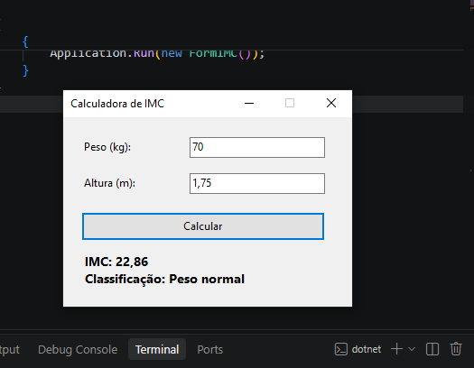

# Calculadora de IMC (Índice de Massa Corporal)

Aplicação desktop desenvolvida em **C# Windows Forms** (.NET) para cálculo do **Índice de Massa Corporal (IMC)** e respetiva classificação de acordo com as diretrizes da Organização Mundial da Saúde (OMS).

---

## 📸 Demonstração da Interface



---

## 📋 Enunciado e Requisitos do Projeto

O programa foi desenvolvido cumprindo rigorosamente todos os requisitos especificados:

- **`txtPeso` (TextBox):** Campo de texto para introduzir o peso em quilogramas (kg).
- **`txtAltura` (TextBox):** Campo de texto para introduzir a altura em metros (m).
- **`btnCalcular` (Button):** Botão com o texto "Calcular" para processar os dados inseridos.
- **`lblResultado` (Label):** Etiqueta onde são apresentados o valor final do IMC e a respetiva classificação.
- **Componente Lógica / Validação Segura:**
  - Validação estritamente numérica utilizando conversão segura (`double.TryParse`) sem disparar exceções de runtime.
  - Suporte tanto a vírgula (`,`) quanto a ponto (`.`) como separador decimal.
  - Verificação de valores estritamente positivos (`> 0`).
  - Aplicação da fórmula padrão do IMC:
    $$\text{IMC} = \frac{\text{peso}}{\text{altura}^2}$$

---

## 📊 Tabela de Classificação do IMC (OMS)

| Faixa de IMC (kg/m²) | Classificação |
| :--- | :--- |
| Abaixo de 18,5 | Abaixo do peso |
| 18,5 a 24,9 | Peso normal |
| 25,0 a 29,9 | Sobrepeso |
| 30,0 a 34,9 | Obesidade grau I |
| 35,0 a 39,9 | Obesidade grau II |
| 40,0 ou superior | Obesidade grau III |

*Exemplo de teste demonstrado na imagem:*
- **Peso:** `70` kg
- **Altura:** `1,75` m
- **Cálculo:** $\frac{70}{1,75^2} = \frac{70}{3,0625} \approx 22,86$
- **Resultado:** `IMC: 22,86` | **Classificação:** `Peso normal`

---

## 🛠️ Tecnologias Utilizadas

- **Linguagem:** C# (.NET 10.0 Windows Forms)
- **Framework:** Windows Desktop SDK (`Microsoft.NET.Sdk`)
- **IDE:** Visual Studio / Visual Studio Code

---

## 🚀 Como Executar o Projeto

### Pré-requisitos
- [.NET SDK](https://dotnet.microsoft.com/download) (versão 8.0, 9.0 ou 10.0) ou Visual Studio com suporte a C# / Windows Forms.

### Opção 1: Linha de Comandos (.NET CLI)
1. Abra um terminal na pasta do projeto:
   ```bash
   cd CalculadoraIMC
   ```
2. Execute o comando:
   ```bash
   dotnet run
   ```

### Opção 2: Visual Studio
1. Abra o ficheiro de solução `IMC_Csharp.slnx` (ou o ficheiro de projeto `CalculadoraIMC.csproj`) no Visual Studio.
2. Pressione **F5** ou clique no botão **Iniciar (Start)** para compilar e executar.

---

## 📁 Estrutura do Projeto

```text
CalculadoraIMC/
├── IMC_Csharp.slnx        # Ficheiro de solução do Visual Studio
├── CalculadoraIMC.csproj   # Ficheiro de configuração do projeto .NET Windows Forms
├── Program.cs             # Código-fonte principal com FormIMC e lógica de cálculo
├── README.md              # Documentação completa do projeto com screenshot
├── screenshot.png         # Captura de ecrã da aplicação em funcionamento
├── form.jpg               # Imagem da interface
└── .gitignore             # Ficheiros ignorados pelo controlo de versões (bin, obj, etc.)
```

---

## 📦 Submissão

- **Ficheiro compactado:** `IMC_Csharp.zip`
- **Repositório GitHub:** `IMC_Csharp` (https://github.com/tiagochauque/IMC_Csharp)
